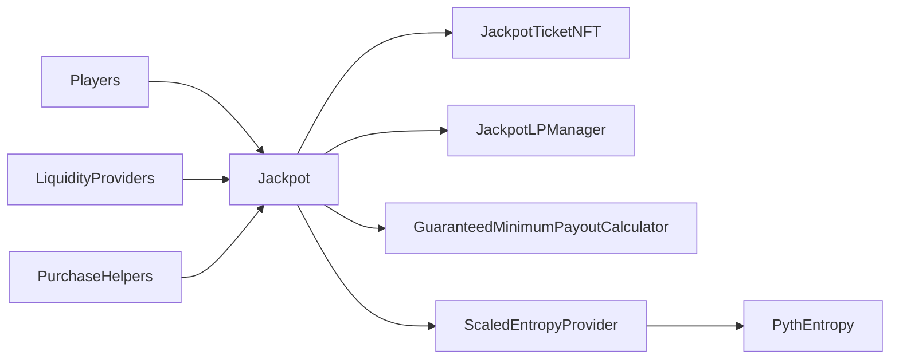
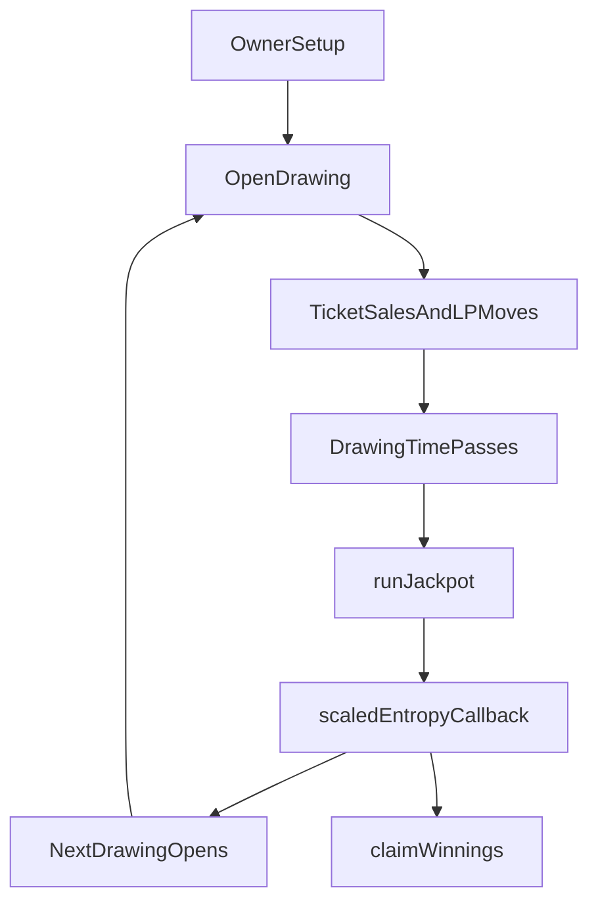

# MegaPot V2 architecture

MegaPot is a USDC jackpot. Players buy tickets for the current drawing. Liquidity providers fund the prize pool and earn an edge on ticket sales. When the drawing time passes, anyone can ask Pyth for the winning numbers. Winners later claim by burning their ticket NFTs.

`Jackpot` is the only contract that holds the core USDC pool. The other contracts are either called by it during a drawing, or they sit in front of `buyTickets` and `claimWinnings` and custody funds only for their own flow. Function-level detail lives in the NatSpec on each contract. This page is the map.

## Contract map



| Contract | Role |
| --- | --- |
| [`Jackpot.sol`](../contracts/Jackpot.sol) | Orchestrates purchases, the draw, settlement, claims, referrals, and LP entry points. Holds the USDC. |
| [`JackpotLPManager.sol`](../contracts/JackpotLPManager.sol) | Share accounting. `Jackpot` is the only caller. |
| [`JackpotTicketNFT.sol`](../contracts/JackpotTicketNFT.sol) | ERC-721 ticket. Stores the packed numbers and the referral scheme. Mint and burn are `Jackpot`-only. |
| [`nftArt/TicketNFTArt.sol`](../contracts/nftArt/TicketNFTArt.sol) | On-chain SVG metadata for the NFT. The NFT contract owner can swap the art contract. |
| [`GuaranteedMinimumPayoutCalculator.sol`](../contracts/GuaranteedMinimumPayoutCalculator.sol) | Turns the prize pool and the winning-combo counts into a payout per tier. |
| [`ScaledEntropyProvider.sol`](../contracts/ScaledEntropyProvider.sol) | Wraps Pyth Entropy. Scales the random bytes into ball numbers and calls back into `Jackpot`. |
| Purchase helpers | [`JackpotBridgeManager`](../contracts/JackpotBridgeManager.sol), [`JackpotAutoSubscription`](../contracts/JackpotAutoSubscription.sol), [`BatchPurchaseFacilitator`](../contracts/BatchPurchaseFacilitator.sol), [`TicketAutoCompoundVault`](../contracts/TicketAutoCompoundVault.sol), [`JackpotRandomTicketBuyer`](../contracts/JackpotRandomTicketBuyer.sol). Each one calls `Jackpot`; none of them settle a drawing. |

Fee-like parameters (`lpEdgeTarget`, `reserveRatio`, `referralFee`, `referralWinShare`, `protocolFee`) are scaled by `PRECISE_UNIT` (`1e18`). USDC amounts use the token's own decimals. Most economic parameters are copied onto the drawing when it opens, so an owner update applies to a future drawing. The payout calculator snapshots its tier config at the same moment via `setDrawingTierInfo`. Settlement reads the live `protocolFee` and `protocolFeeThreshold` in `_transferProtocolFee`, so an owner change applies to the drawing that is about to settle.

## Drawing lifecycle



Setup is three owner calls, in order, on [`Jackpot`](../contracts/Jackpot.sol):

1. `initialize` wires USDC, the LP manager, the NFT, the entropy provider, the payout calculator, and the protocol-fee recipient.
2. `initializeLPDeposits` sets the governance pool cap and asks the LP manager to set the drawing-0 accumulator to `1e18`. LPs deposit against drawing 0 after this call. `initializeJackpot` reverts if those pending deposits are empty.
3. `initializeJackpot` settles drawing 0 (no earnings, no winnings) so the pending deposits become the first LP value, then opens drawing 1 at `_initialDrawingTime`. Ticket purchases turn on here.

An open drawing accepts `buyTickets` until it is locked. `lpDeposit` and `initiateWithdraw` also revert while `jackpotLock` is set. The owner can lock or unlock the drawing directly, and can turn ticket purchases off without locking LP moves.

After `drawingTime`, anyone can call `runJackpot` and attach at least the Pyth fee in ETH. Excess ETH is refunded to the caller. The call locks the drawing and asks `ScaledEntropyProvider` for two sets: 5 normal balls drawn without replacement from `1..ballMax`, and 1 bonusball from `1..bonusballMax`. The callback selector stored on the request is `scaledEntropyCallback`.

`scaledEntropyCallback` accepts calls only from the configured entropy provider, and only while the drawing is locked. It counts winning combos, stores the per-tier payout, takes the protocol fee, updates LP value, and opens the next drawing in `_setNewDrawingState`. That helper increments `currentDrawingId`, funds the new prize pool from the new LP value, picks the next `bonusballMax`, and initializes an empty combo tracker. The settled drawing stays readable at `currentDrawingId - 1`.

`claimWinnings` pays the NFT owner for tickets whose drawing id is already behind `currentDrawingId`, then burns the NFT. Burning is what prevents a second claim.

If a drawing cannot be settled, the owner turns on emergency mode. Ticket holders of the *current* drawing call `emergencyRefundTickets` (full price, or price minus the purchase referral fee). LPs call `emergencyWithdrawLP` and receive every position they still have. Normal purchases, draws, and LP moves stay disabled while emergency mode is on.

## Tickets and payout tiers

A ticket is 5 unique normal numbers plus 1 bonusball. [`TicketComboTracker`](../contracts/lib/TicketComboTracker.sol) packs the normals into a bit vector (bit `n` set means ball `n`) and stores the bonusball in the bits above `normalBallMax`. The NFT keeps that packed word. The token id is `keccak256(drawingId, ticketIndex, packedTicket)`.

The tier id is `2 * normalMatches + bonusballMatch`, which is 12 tiers: zero through five normal matches, each with and without the bonusball. `Jackpot._calculateTicketTierId` computes it with a bitwise AND and a popcount. Tier 0 (no normals, no bonusball) is ineligible for a minimum payout, and its premium weight must be zero.

Settlement counts matches from the combo tracker. On each purchase, `insert` records the combination and every subset of it, split into a unique count and a duplicate count. At draw time, `countTierMatchesWithBonusball` applies inclusion-exclusion over those subset counts to produce two length-12 arrays: user tickets holding a unique winning combo, and extra copies of a combo someone already bought. Settlement uses those two arrays as the user-held winner counts.

Duplicate combos are allowed. The first sale of a combo leaves `prizePool` unchanged, because the pool was already funded by LPs. Each extra copy grows `prizePool` by `ticketPrice - edgePerTicket`, which is `ticketPrice * (1 - lpEdgeTarget)`. The extra ticket is covered by the pool at the same edge the LPs were promised.

[`GuaranteedMinimumPayoutCalculator`](../contracts/GuaranteedMinimumPayoutCalculator.sol) then prices each tier:

- The winner count for a tier is every possible winning combination in that tier, plus user-held duplicates. Unsold combinations are treated as LP-owned.
- An eligible tier pays `minimumPayout` per ticket in that count, and only when `prizePool * premiumTierMinAllocation / 1e18 + winnerCount * minimumPayout` is strictly less than `prizePool`. If the sum is equal or greater, minimums are off and the whole pool is split by weight. The minimum reserved for unsold combinations is withheld from the premium pot and stays in the LP pool. Only user-held tickets (`uniqueResult + dupResult`) are paid.
- Whatever remains (or the whole pool) is split by `premiumTierWeights`. Weights are 12 values and must sum to `1e18`. A ticket's premium is that tier's weighted share divided by the tier's winner count, so LP-owned combinations dilute the per-ticket amount and their share stays in the pool.
- The value returned to `Jackpot` is the sum owed to user-owned tickets only (`uniqueResult + dupResult`, times the per-ticket tier payout). That number is `drawingUserWinnings` in the settlement math below.

The per-ticket amount is stored on the calculator for that drawing. `claimWinnings` reads it later.

## Money

A drawing opens with:

```text
prizePool = lpValue * (1 - reserveRatio)
```

The rest of the LP value stays as reserve and is not offered as prizes. A later duplicate sale adds `ticketPrice - edgePerTicket` to that pool, as described above.

Ticket proceeds land in `Jackpot` immediately. A purchase-time referral fee (`ticketsValue * referralFee`) is credited to the referrers' `referralFees` balances, and the remainder is added to the drawing's `lpEarnings`. Referrers pull the balance with `claimReferralFees`. A referral scheme is the pair of referrer addresses and `1e18`-scaled splits; the scheme id is `keccak256` of that pair, and it is stored on the NFT so a later winning share follows the ticket even if the NFT is transferred.

At claim time, `referralWinShare` of the gross winning amount is taken back out. With a referral scheme, that share is split onto the same `referralFees` balances. With no scheme, it is added to the *current* drawing's `lpEarnings` (the drawing that is open when the user claims). If that drawing has no LP value, or emergency mode is on, the winner keeps the share.

On settlement the LP pool is marked to the drawing result before pending deposits and withdrawals move:

```text
postDrawLpValue = lpPoolTotal + lpEarnings - userWinnings - protocolFee
```

`userWinnings` is the user-owned portion from the payout calculator. The protocol fee is charged only when `lpEarnings - userWinnings` is above `protocolFeeThreshold`. The fee is `protocolFee` times the profit past that threshold, and it is transferred to `protocolFeeAddress` in the callback.

[`JackpotLPManager`](../contracts/JackpotLPManager.sol) prices shares with a per-drawing accumulator. Drawing 0 stays at the initial `1e18`. From drawing 1 on, a non-zero pool updates it to:

```text
newAccumulator = previousAccumulator * postDrawLpValue / lpPoolTotal
```

If `lpPoolTotal` is zero, the new accumulator is `1e18`.

Deposits are USDC and stay pending until the drawing they were submitted in settles. They fund the *next* drawing's pool (`newLpValue = postDrawLpValue + pendingDeposits - withdrawalsInUSDC`), converted to shares at the new accumulator. Withdrawals are two steps. `initiateWithdraw` moves consolidated shares to pending while the drawing is unlocked; those shares leave the pool at settlement, converted at the new accumulator. `finalizeWithdraw` pays out USDC once the drawing they were requested in has settled and the shares have been consolidated into `claimableWithdrawals`. A deposit or withdrawal from an earlier drawing is consolidated into shares or claimable USDC the next time that LP touches their position.

`bonusballMax` for the new drawing grows with the prize pool, clamped to `[bonusballMin, bonusballHardCap]`. The uncapped value is the number of bonusball faces needed so the combination space (`C(normalBallMax, 5)` per face) can cover the prize pool at the target edge. The hard cap exists so the packed ticket and the settlement gas stay bounded. `normalBallMax + bonusballHardCap` must be at most 255, which keeps the bonusball bit inside a `uint256`.

The LP soft cap is that same combinatorial limit, valued at the edge and grossed up by the reserve ratio:

```text
maxTickets = C(normalBallMax, 5) * bonusballSoftCap
softCap    = maxTickets * ticketPrice * (1 - lpEdgeTarget) / (1 - reserveRatio)
```

`lpPoolCap` is the minimum of that soft cap and `governancePoolCap`. The deposit check uses the pre-settlement estimate: `lpPoolTotal + pending deposits − pending withdrawals`, with withdrawals priced at the previous accumulator. A deposit that would push that estimate over `lpPoolCap` reverts. Settlement does not re-check the cap, so later profits can still grow the pool past it. Once the estimate is at the cap, further deposits revert. Crossing the bonusball hard cap is what starts to dilute the per-ticket edge, because the combination space stops growing with the pool.

## Two randomness systems

Winning numbers come from Pyth. [`ScaledEntropyProvider`](../contracts/ScaledEntropyProvider.sol) takes a fee, stores the request, and on `entropyCallback` expands the Pyth bytes with Fisher-Yates rejection sampling ([`FisherYatesWithRejection.sol`](../contracts/lib/FisherYatesWithRejection.sol)) so each ball is uniform in its range. `requestAndCallbackScaledRandomness` is limited to allowlisted callers, so `Jackpot` has to be allowed on the provider before `runJackpot` works. `runJackpot` itself is permissionless. `Jackpot` accepts `scaledEntropyCallback` only when `msg.sender` is the entropy provider.

[`TicketPicker`](../contracts/lib/TicketPicker.sol) is a separate on-chain picker. Helpers use it when they need to choose numbers on the user's behalf (`pickAuto` and the single-ticket helpers). It mixes `prevrandao`, a blockhash, a domain separator, and a nonce. Winning numbers stay on the Pyth path above.

## Contracts in front of Jackpot

These contracts pull USDC from a user (or hold it prepaid) and call `buyTickets`. The prize pool stays in `Jackpot`.

- [`JackpotBridgeManager`](../contracts/JackpotBridgeManager.sol) buys tickets on the jackpot's chain and holds the NFTs. The user later signs an EIP-712 `ClaimWinningsData` or `ClaimTicketData` message. A relayer submits the signature. `claimWinnings` forwards the USDC through [`IRelayDepository`](../contracts/interfaces/IRelayDepository.sol). Ticket ownership inside the bridge is tracked separately from the NFT, which stays in the bridge until `claimTickets` transfers it out.
- [`JackpotAutoSubscription`](../contracts/JackpotAutoSubscription.sol) holds prepaid USDC for a recipient and stores a mix of static numbers and a dynamic ticket count. An allowlisted keeper calls `executeSubscriptions`. Each subscription runs at most once per drawing, and the keeper can call again for other recipients. A ticket-price change, or a referrer list longer than `maxReferrers`, cancels the subscription and refunds the remainder. When that day's ticket count is at least the batch facilitator's minimum, the order is handed to the facilitator and a keeper fills it across later transactions.
- [`BatchPurchaseFacilitator`](../contracts/BatchPurchaseFacilitator.sol) stores a single-drawing order and lets an allowlisted keeper fill it across transactions, up to a max ticket count per call. A locked drawing, a drawing mismatch, or a referrer list that no longer fits cancels the order and refunds. Auto-subscription and the vault both route oversized buys here.
- [`TicketAutoCompoundVault`](../contracts/TicketAutoCompoundVault.sol) takes a one-time `setApprovalForAll` from the user. `depositAndCompound` pulls the winning NFTs in, calls `claimWinnings`, and spends the USDC (plus any leftover balance) on new tickets minted to the user. A purchase at or above the facilitator's minimum becomes a batch order for that same user, filled when a keeper runs it.
- [`JackpotRandomTicketBuyer`](../contracts/JackpotRandomTicketBuyer.sol) is a thin wrapper: it draws `_count` tickets with `TicketPicker.pickAuto`, pulls the exact USDC cost, and forwards them to `buyTickets`.

`JackpotAutoSubscription`, `BatchPurchaseFacilitator`, and `ScaledEntropyProvider` all inherit [`AllowedManager`](../contracts/lib/AllowedManager.sol). The owner maintains the allowlist those keepers and callers must be on.

## Where to read next

Read in this order:

1. The external functions in [`contracts/Jackpot.sol`](../contracts/Jackpot.sol): `buyTickets`, `claimWinnings`, the three LP entry points, `runJackpot`, `scaledEntropyCallback`, then `_setNewDrawingState`.
2. [`contracts/JackpotLPManager.sol`](../contracts/JackpotLPManager.sol), especially `processDeposit`, `processInitiateWithdraw`, `processFinalizeWithdraw`, and `processDrawingSettlement`.
3. [`contracts/GuaranteedMinimumPayoutCalculator.sol`](../contracts/GuaranteedMinimumPayoutCalculator.sol) `calculateAndStoreDrawingUserWinnings`.
4. [`contracts/lib/TicketComboTracker.sol`](../contracts/lib/TicketComboTracker.sol) `insert` and `countTierMatchesWithBonusball`.
5. One satellite, starting with whichever flow you are changing.

Tests mirror the contract names:

| Area | Test |
| --- | --- |
| Core drawing | [`test/jackpot.spec.ts`](../test/jackpot.spec.ts) |
| LP accounting | [`test/jackpotLPManager.spec.ts`](../test/jackpotLPManager.spec.ts) |
| Bridge | [`test/jackpotBridgeManager.spec.ts`](../test/jackpotBridgeManager.spec.ts) |
| NFT | [`test/jackpotTicketNFT.spec.ts`](../test/jackpotTicketNFT.spec.ts) |
| NFT art | [`test/ticketNFTArt.spec.ts`](../test/ticketNFTArt.spec.ts) |
| Payouts | [`test/guaranteedMinimumPayoutCalculator.spec.ts`](../test/guaranteedMinimumPayoutCalculator.spec.ts) |
| Entropy | [`test/scaledEntropyProvider.spec.ts`](../test/scaledEntropyProvider.spec.ts) |
| Auto-subscription | [`test/jackpotAutoSubscription.spec.ts`](../test/jackpotAutoSubscription.spec.ts) |
| Batch orders | [`test/batchPurchaseFacilitator.spec.ts`](../test/batchPurchaseFacilitator.spec.ts) |
| Auto-compound | [`test/ticketAutoCompoundVault.spec.ts`](../test/ticketAutoCompoundVault.spec.ts) |
| Random buyer | [`test/jackpotRandomTicketBuyer.spec.ts`](../test/jackpotRandomTicketBuyer.spec.ts) |
| Full drawings | [`test/e2e/coreScenarios.spec.ts`](../test/e2e/coreScenarios.spec.ts), [`test/e2e/globalParamVariation.spec.ts`](../test/e2e/globalParamVariation.spec.ts), [`test/e2e/payoutModel.spec.ts`](../test/e2e/payoutModel.spec.ts) |
| Libraries | [`test/lib/`](../test/lib/) |

[`utils/test/jackpotFixture.ts`](../utils/test/jackpotFixture.ts) deploys the core system the unit tests use. [`utils/protocolUtils.ts`](../utils/protocolUtils.ts) is the off-chain mirror of the math those tests assert against: packed tickets, bonusball sizing, tier payouts, and the bridge EIP-712 hashes. [`utils/deploys.ts`](../utils/deploys.ts) is the deployment helper behind the fixture.
